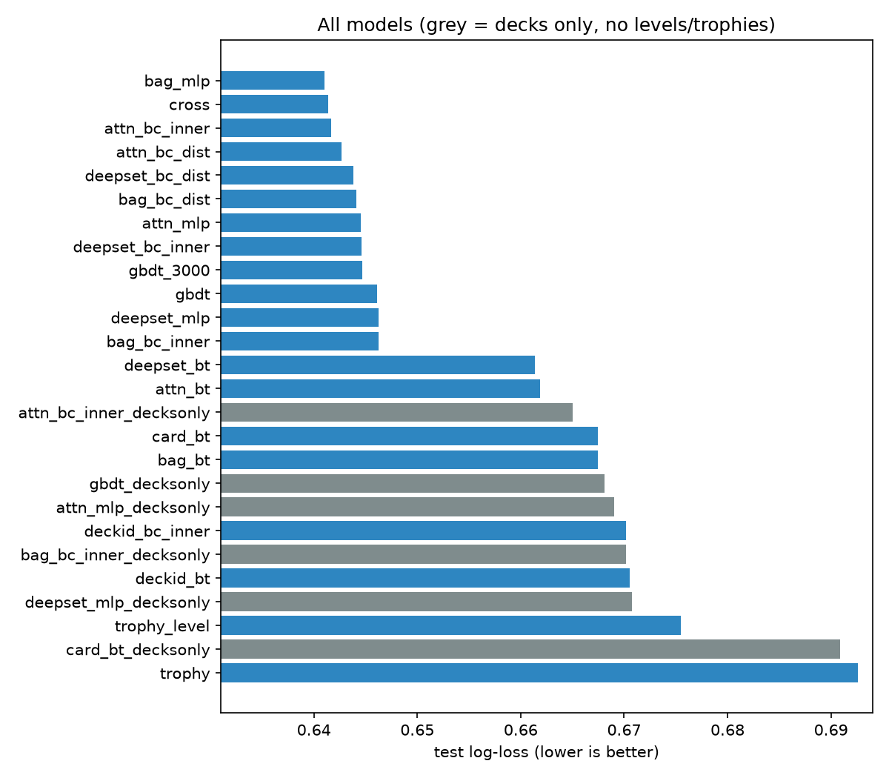

# Predicting Clash Royale match outcomes from decks, card levels and trophies

*Run of 27–28 Oct 2026. All numbers come from `results/` and can be regenerated with `run_all.sh` + `src/analyze.py`.*

## TL;DR

- **Task.** Given both 8-card decks, each card's level, and both players' trophies, predict who wins.
- **Data.** 2.35M normal-ladder matches from about 27 hours of Season 18 ladder (28 Dec 21:00 to 30 Dec 00:05 UTC, 2020).
- **Best model: 62.3% test accuracy, log-loss 0.641.** For comparison, a coin flip is 50% / 0.693, and summing per-card strengths (Bradley–Terry) is 57.8% / 0.668.
- **Most of the gain comes from modelling matchups, not deck strength.** Swapping the transitive "deck strength" head for an intransitive one (blade-chest or MLP) gains about 0.02 log-loss and 4 points of accuracy with *any* encoder. A better encoder with a transitive head gains only about 0.006.
- **A simple deck encoder is enough.** A sum of learned card embeddings with an MLP matchup head matches attention and cross-attention models. It trains in about 1 minute, against 33 minutes for attention and 2.9 hours for cross-attention.
- **Decks really are rock-paper-scissors.** Among the 100 most-played decks, about **50–60%** of the variance in the learned matchup logits is cyclic, meaning no single strength ranking can explain it. About 12–16% of deck triples form strict loops. The model's matchup probabilities correlate **0.76** with raw head-to-head win rates.
- **Card levels matter almost as much as the decks.** Removing levels and trophies drops the best model from 62.3% to 58.8% accuracy.

---

## 1. Prior work (what people have done)

| Work | Data | Approach | Result |
|---|---|---|---|
| [AAIA'19 / FedCSIS Clash Royale challenge](https://fedcsis.org/2019/aaia/dm) ([paper](https://www.researchgate.net/publication/336071640_Clash_Royale_Challenge_How_to_Select_Training_Decks_for_Win-rate_Prediction)) | Deck-level win rates | Pick training decks to predict *deck* win rates. The winners used SVMs with greedy selection ([EBTIC](https://www.ku.ac.ae/making-incremental-support-vector-regression-greedy-to-win-the-clash-royale-competition-2019)). | Different target (deck win rate, not match outcome) |
| [jdleo blog (2024)](https://jdleo.me/blog/clash-royale-ai-deck-prediction) | 70K war-day battles, decks only | Multi-hot cards → LightGBM / MLP | **57.0–57.3%** accuracy |
| [fossilM/ClashML](https://github.com/fossilM/ClashML) | 77 battles | Hand-made deck features → RF / SVM | ~72–75%, but on a tiny sample and not reliable |
| [Devpost S18 analysis](https://devpost.com/software/clash-royale-s18-card-deck-analysis) | Same S18 dataset | Card and deck statistics | Descriptive only |
| [Harry Cheng, Medium](https://harrychengz.medium.com/how-data-science-can-help-you-play-clash-royale-better-517fb840168d) | Ladder battles | Logistic regression on card-level gap and deck stats | ~60% accuracy, AUC ~0.68 (from a search snippet; the page itself would not load, so not verified) |
| [grandediw project](https://grandediw.github.io/Clash-Royale-Project/) | 2.5M matches (Hugging Face), decks only | One-hot decks → TF neural net / XGBoost | NN 56.6%; XGBoost **84.3%**. The 84% is not believable next to the NN and every other decks-only result; probably leakage. |
| [stephenkwok85/Clash_Royale_Prediction](https://github.com/stephenkwok85/Clash_Royale_Prediction) | Same S18 dataset, 2.6M matches | Hand-made level/elixir/rarity gap features → LR / RF / GBDT | **97.7%**, AUC 0.999. Not possible from pre-match information; almost certainly leakage (e.g. the winner/loser column layout or mirrored rows across splits). |
| [nonrice predictor](https://github.com/nonrice/clash-royale-battle-predictor) (author of the Dec 2021 dataset), [sijun-kevin-hu/clash_predict](https://github.com/sijun-kevin-hu/clash_predict), [aviraltrip/CR_ML_Analytics](https://github.com/aviraltrip/CR_ML_Analytics), [lijames9/clash-royale-analytics](https://github.com/lijames9/clash-royale-analytics) | API-scraped battles | NN / XGBoost / LR on decks + levels + trophies | No metrics reported |
| Shin & Kim, "Winner prediction for real-time strategy games through feature selection based on a genetic wrapper" ([GECCO'21 poster](https://doi.org/10.1145/3449726.3462735)) | ? | Genetic-algorithm feature selection | Paywalled 2-page abstract. I could not confirm which game it uses or what it reports. |
| [Heo & Kim, CoG'26](https://arxiv.org/abs/2605.21868) | 926K Clash Royale matches | Pre-trained player/strategy encoder | Predicts win-rate change from switching decks, not match outcomes |
| Jakubik, [AAIA'18 Hearthstone](https://annals-csis.org/Volume_15/drp/365.html) | Hearthstone matches | Neural deck encoder trained on match log-likelihood, one win-rate scalar per deck | Closest in method, but transitive (equivalent to our `*_bt` heads) and predicts deck win rates |
| Dota 2 draft prediction ([e.g.](https://arxiv.org/pdf/2106.01782)) | Hero picks | Logistic regression ≈ NN ≈ 60–70%; hero embeddings with synergy and counter terms | Logistic regression is hard to beat; counter terms help |
| Chen et al. 2018, avatar synergy/opposition embeddings (MOBA); [DraftRec](https://arxiv.org/pdf/2204.12750) | LoL / Dota 2 drafts | Hero embeddings with explicit opposition (counter) terms | Same idea as ours at the item level, for 5v5 drafts rather than 8-card decks |
| Chen & Joachims, blade-chest ([WSDM'16](https://github.com/csinpi/blade_chest), [KDD'16](https://videolectures.net/kdd2016_chen_predicting_matchups)) | Sports, games, preferences | Each player gets a "blade" and a "chest" vector, allowing intransitive matchups. KDD'16 makes them functions of features. | Beats BT when matchups are cyclic. Known to be hard to fit. |
| Balduzzi et al., [Re-evaluating Evaluation (mElo)](https://arxiv.org/pdf/1806.02643) | AI agents / games | Elo plus a low-rank antisymmetric term; Hodge split into transitive and cyclic parts | The basis for our transitive/cyclic analysis |

**Takeaway:** there is more Clash Royale outcome-prediction work than first listed, but it is mostly hobby projects with hand-made features, no learned deck embeddings and no intransitive matchup term. The believable numbers are about 57% decks-only and about 60% with levels (unverified). The results above 80% look like leakage. I found no work combining (a) learned deck embeddings *built from cards*, (b) an explicit intransitive matchup head, and (c) card levels and trophies at the scale of millions of matches. The closest methods are Jakubik's Hearthstone deck encoder (transitive only) and MOBA hero-embedding models with opposition terms. We get 58.8% decks-only and 62.3% with levels and trophies.

## 2. Data

- **Source:** `bwandowando/clash-royale-season-18-dec-0320-dataset`, file `BattlesStaging_12292020_WL_tagged.csv` (1.38 GB). It spans 28 Dec 21:00 UTC to 30 Dec 00:05 UTC.
- **Cleaning:** [`src/prepare_s18.py`](src/prepare_s18.py). Of 2,345,681 raw rows, 2,345,593 are normal ladder (`gameMode.id = 72000006`). After removing 1 duplicate, **2,345,592** remain. All decks were valid: 8 distinct, known cards with levels in 1–13.
- **Columns kept:** for each side, the 8 card IDs, the 8 card levels and the starting trophies, plus player tags (used only for analysis) and the time. All in-match statistics (crowns, tower HP, trophy change and so on) were dropped.
- **Sides:** winner and loser are assigned to sides A and B at random. A wins in 49.97% of matches.
- **Split:** by time. The first 80% of matches are train (1.88M), the next 10% validation (235K) and the last 10% test (235K, the final ~2.5 h). There are 1.94M unique players, so the same player rarely appears in both train and test.
- **Scale of the inputs:**
  - Trophies have a median of about 4,800, with a 1st–99th percentile range of 1.5K–6.4K.
  - Matchmaking is tight: the median trophy gap is 8.
  - The side with the higher total card level wins 58.8% of matches.

## 3. Models

All models output a logit with **logit(A, B) = −logit(B, A)**, so P(A beats B) + P(B beats A) = 1 always holds. They all share a linear trophy-gap term. Code: [`src/models.py`](src/models.py).

**Baselines:**
- `trophy`: logistic regression on the trophy gap.
- `trophy_level`: adds the gap in total card level.
- `card_bt`: Bradley–Terry with deck strength = Σ (card strength + card-specific level slope × level).
- `gbdt`: gradient-boosted trees on level-weighted card presence, total level and trophies, antisymmetrised.

**Siamese encoder × pairing head.** The same encoder embeds both decks, and a head pairs the two embeddings. Card tokens are a card embedding plus a card-specific level direction × the card's level.

| Encoder | Description |
|---|---|
| `bag` | Sum of the 8 card tokens (linear) |
| `deepset` | ρ(Σ φ(token)): nonlinear, permutation-invariant |
| `attn` | 2-layer self-attention over the 8 cards, then mean-pooled |

| Head | Matchup logit | Intransitive? |
|---|---|---|
| `bt` | s(A) − s(B) | No |
| `bc_inner` | s(A) − s(B) + blade_A·chest_B − blade_B·chest_A | Yes |
| `bc_dist` | s(A) − s(B) + ‖blade_B − chest_A‖² − ‖blade_A − chest_B‖² | Yes |
| `mlp` | g(z_A, z_B) − g(z_B, z_A) | Yes, unrestricted |

**Others:**
- `cross`: a 3-layer transformer over all 16 cards, with a side embedding marking which deck each card belongs to. Attention can therefore compare cards across the two decks directly.
- `deckid_*`: classic blade-chest, with one free vector per deck that has at least 20 training plays. That is 7,328 of 1.52M unique decks, covering only 24% of train and 20% of test deck appearances. The rest share an "unseen" vector.

**Training:** AdamW (lr 2e-3, weight decay 1e-5), batch size 8192, early stopping on validation log-loss (patience 3, at most 40 epochs). Everything ran on the M5 GPU (MPS).

## 4. Results

Test set: 234,559 matches. Δ is the paired difference in test log-loss against `card_bt`, with a 95% bootstrap CI. Full table: [`results/summary.md`](results/summary.md) and [`results/all_runs.csv`](results/all_runs.csv).

| Model | Params | Test log-loss | Test acc | AUC | Δ vs card_bt |
|---|---:|---:|---:|---:|---|
| constant | 0 | 0.6931 | 50.1% | 0.500 | +0.026 |
| trophy | 2 | 0.6926 | 51.2% | 0.518 | +0.025 |
| trophy_level | 2 | 0.6755 | 56.4% | 0.600 | +0.008 |
| **card_bt** | 205 | 0.6675 | 57.8% | 0.619 | 0 |
| deckid_bt | 235K | 0.6705 | 57.0% | 0.607 | +0.003 |
| deckid_bc_inner | 236K | 0.6702 | 57.0% | 0.608 | +0.003 |
| deepset_bt | 178K | 0.6613 | 58.7% | 0.631 | −0.006 |
| attn_bt | 113K | 0.6618 | 58.6% | 0.629 | −0.006 |
| gbdt (converged at 1,480 iterations) | — | 0.6447 | 61.9% | 0.669 | −0.023 |
| bag_bc_inner | 15K | 0.6463 | 62.1% | 0.670 | −0.021 |
| bag_bc_dist | 15K | 0.6441 | 62.2% | 0.673 | −0.023 |
| deepset_bc_dist | 180K | 0.6438 | 62.0% | 0.671 | −0.024 |
| attn_bc_inner | 115K | 0.6417 | 62.2% | 0.674 | −0.026 |
| cross | 172K | 0.6413 | 62.2% | 0.674 | −0.026 |
| **bag_mlp** | 112K | **0.6410** | **62.3%** | **0.676** | **−0.027** [−0.027, −0.026] |



**The head matters more than the encoder.** Holding the encoder fixed and changing only the head (test log-loss):

| Encoder | BT | bc_inner | bc_dist | MLP |
|---|---:|---:|---:|---:|
| bag | 0.6675 | 0.6463 | 0.6441 | **0.6410** |
| deepset | 0.6613 | 0.6446 | 0.6438 | 0.6462 |
| attn | 0.6618 | **0.6417** | 0.6427 | 0.6445 |

**Blade-chest dimension.** Sweeping k for `bag_bc_inner` gives a clean dose-response curve. k = 1 is already better than BT, and the gains stop around k ≈ 16–32.

| k | 1 | 2 | 4 | 8 | 16 | 32 | 64 |
|---|---|---|---|---|---|---|---|
| test log-loss | 0.6613 | 0.6574 | 0.6524 | 0.6484 | 0.6463 | 0.6459 | 0.6459 |
| test acc | 59.3% | 60.1% | 61.1% | 61.8% | 62.1% | 62.2% | 62.2% |

**Decks only (no levels or trophies):**

| Model | Test log-loss | Test acc |
|---|---:|---:|
| card_bt | 0.6909 | 52.0% |
| gbdt | 0.6681 | 58.4% |
| bag_bc_inner | 0.6702 | 58.4% |
| attn_mlp | 0.6690 | 58.0% |
| **attn_bc_inner** | **0.6650** | **58.8%** |

With decks alone, a *transitive* model is nearly useless (52%), while matchup models reach about 58–59%. This is in line with the ~57% reported in prior decks-only work. Levels and trophies add about 3.5 more points.

**Calibration:** the best model is well calibrated across the full 0–1 range ([figure](results/figures/calibration.png)).

**Where the trees' edge came from** ([`results/diag_gbdt.txt`](results/diag_gbdt.txt)). The trees reach 0.6728 on levels and trophies alone and 0.6752 on cards alone, but 0.6518 with both. Their advantage over BT therefore comes from interactions, the same structure the matchup heads capture.

## 5. What the models learned

**Card levels.** One extra card level is worth +0.069 logit. Being a full level up on all 8 cards gives a **63.5%** win probability against an otherwise identical opponent.

**Card strengths** (the transitive part, `card_bt`):
- **Strongest:** Electro Giant, Skeleton Barrel, Lava Hound, Cannon Cart, Bowler, Mega Knight.
- **Weakest:** Elixir Golem, Mirror, Minion Horde, Wizard, Archers, Baby Dragon.

([figure](results/figures/card_strengths.png), [csv](results/card_strengths.csv))

**Card-vs-card counters.** With the linear `bag_bc_inner` model, the matchup term splits exactly into card-pair terms Kᵢⱼ = eᵢᵀ S eⱼ. The largest ones are well-known counters:

| Counter | Logit |
|---|---:|
| P.E.K.K.A vs Electro Giant | +0.61 |
| Sparky vs Electro Giant | +0.59 |
| Electro Dragon vs Sparky | +0.42 |
| Graveyard vs Bomb Tower | +0.41 |
| Inferno Dragon vs P.E.K.K.A | +0.41 |
| Giant vs X-Bow | +0.40 |
| Inferno Tower vs Golem | +0.39 |
| Lava Hound vs Cannon | +0.38 |

The model learned that Electro Giant is the strongest card on average *and* the most counterable. That is exactly the kind of structure a transitive model can't represent.

**How intransitive are decks?** For the top 100 decks at equal levels, I split each model's matchup matrix into a transitive part (a ranking) and a cyclic remainder (a Hodge-style decomposition):

| Model | Matchup logit std | Cyclic share of variance | Cyclic triangles (top 60) |
|---|---:|---:|---:|
| card_bt / deepset_bt | 0.21 / 0.37 | 0% (by construction) | 0% |
| bag_bc_dist | 0.50 | 60% | 16% |
| attn_bc_inner | 0.61 | 64% | 16% |
| cross | 0.56 | 59% | 15% |
| bag_mlp | 0.67 | 50% | 12% |

Every intransitive model, whatever its architecture, puts **about half or more** of the matchup structure in cycles.

**Example rock-paper-scissors loop** (`bag_mlp`, each deck beats the next with p = 0.72, 0.71 and 0.74):
1. Giant/Prince/Miner + Dark Prince, Mega Minion, E-Wiz, Fireball, Zap
2. beats X-Bow (Archers, Skeletons, Ice Spirit, Ice Golem, Tesla, Fireball, Log)
3. which beats spam (Barbarians, Skarmy, Bomber, Musketeer, Spear Gobs, Minion Horde, Goblin Hut, Barb Hut)
4. which beats deck 1.

**Sanity check against the raw data.** 102 pairs among the top-100 decks met each other at least 100 times. The model's predicted matchups correlate **0.76** with their observed head-to-head win rates ([figure](results/figures/h2h_check.png)).

**Deck embedding map.** Projecting the top 2,000 decks' embeddings to 2D separates archetypes without any labels: Golem beatdown, Lava/Balloon air, Hog/Royal Giant cycle, and Goblin-Barrel bait ([figure](results/figures/deck_embeddings.png)). The full matchup matrix is in [this figure](results/figures/matchup_matrix.png).

## 6. Caveats

- **Single seed.** The top 5 models are within 0.002 log-loss of each other. The bootstrap CIs only cover test-set noise, not training noise, so I can't rank the top models yet. The planned seed repeats ([`run_round2.sh`](run_round2.sh)) were deferred.
- **One day, one meta.** All results come from one ~27-hour window (28–30 Dec 2020). Testing on a different day (another S18 file) or on the Dec 2021 `nonrice` data would show whether the results generalise across metas.
- **Not finished:** `cross_decksonly` was stopped after about 3 h without a result. Little is lost, because `attn_bc_inner_decksonly` covers the same question.
- **Missing skill information.** Player skill is only partly captured by trophies, and the trophy gap is small (median 8). Accuracy around 62% may be close to the limit for these inputs, because the rest depends on how the match is played.
- **Win-condition labels** for the plots come from the dataset's own `Wincons.csv`, which counts Baby Dragon as a win condition.
- **Equal-level analysis:** the matchup analysis in section 5 holds all cards at level 12 and trophies equal, which isolates the deck effect.

## 7. Suggested next steps

1. **Round 2** ([`run_round2.sh`](run_round2.sh)): 3 seeds of the top models, plus small tuning of capacity and regularisation (about 1–1.5 h).
2. **Generalisation across time:** train on 12/29 and test on 12/30 or 12/31 (one more ~1.4 GB file).
3. **A context effect for levels:** let the level gap change the matchup (for example, interact the level gap with the blade-chest terms) rather than only shift strength.
4. **Use blade-chest for deck recommendation:** given an opponent distribution (the meta), find the deck that maximises expected win rate.

## Reproduce

See [README.md](README.md) for setup on any OS.

```bash
python src/download_data.py
python src/prepare_s18.py data/raw/s18/BattlesStaging_12292020_WL_tagged.csv
bash run_all.sh                   # ~8 h total on M5; the cross-attention runs are ~3 h each
python src/analyze.py             # tables + figures → results/
```
