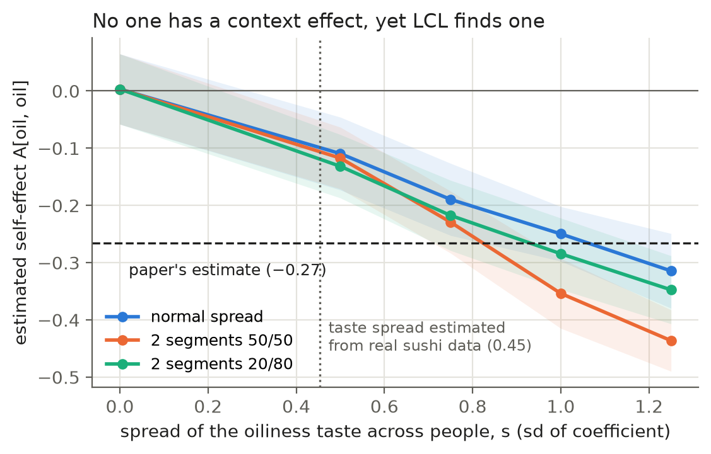
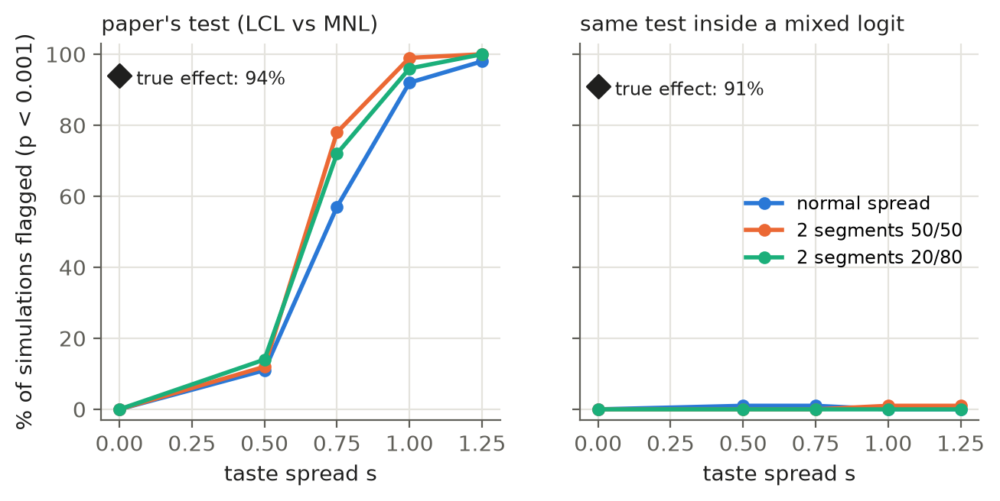
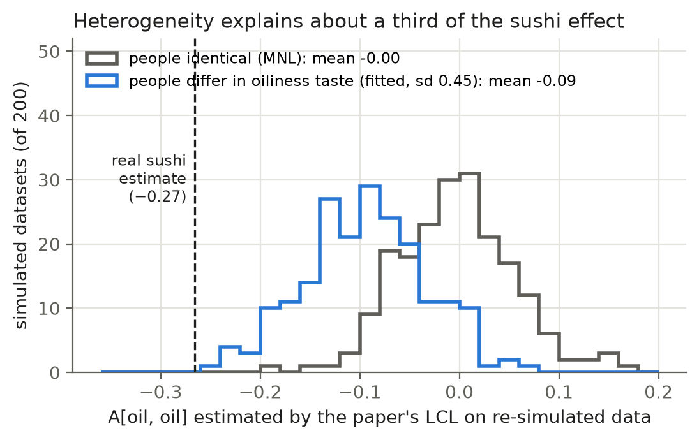

# Context effect, or just different people? Re-examining LCL's sushi finding

*Overnight run, 8 Nov 2026. Every number comes from `results/` and can be regenerated with the
commands in [README.md](README.md). This is a findings write-up for planning the LaTeX report,
not the report itself.*

## TL;DR

- **The claim we test.** Tomlinson & Benson's headline sushi result is that people avoid oily
  sushi more when the menu is oilier: LCL self-effect A[oil, oil] = −0.20 in the full model,
  −0.27 when fitted alone, p = 1.6×10⁻⁶. Because sushi menus are random, the paper suggests this
  could be causal.
- **The catch.** Random menus rule out *confounding*. They do not rule out **people simply
  differing in how much they like oily food**. Throughout, "heterogeneity" means exactly that:
  differences in taste across people.
- **Theory.** To second order, a population whose oiliness taste has variance s² behaves like a
  single chooser with two extra terms: a curvature term +½s²·x², and a set-dependent slope −s²·m_C.
  Here m_C is the choice-weighted mean oiliness of the menu. The second term *is* an LCL-style
  negative self-effect, so heterogeneity mimics the paper's finding by construction. A check
  against the exact model confirms the expansion at small s.
- **Simulation.** These runs use the real sushi menus and two kinds of heterogeneity: a continuous
  normal spread, and discrete segments (50/50 and 20/80).
  - With **no context effect at all**, a taste spread of s ≈ 0.8–1.0 reproduces the paper's −0.27.
  - The paper's test then flags a "context effect" in 57–99% of datasets.
  - The same test inside a mixed logit, i.e. a model that allows people to differ, flags 0–1%,
    yet it still detects a real effect of the paper's size 91% of the time.
  - Adding a squared term instead does **not** fix the problem, as the theory predicts.
- **Real sushi data.** Each result below comes with a check that it is trustworthy.
  1. **Tastes differ.** The estimated sd of the oiliness taste is 0.45. A one-parameter mixed
     logit beats MNL by 14 log-likelihood points and beats the one-entry LCL at the same
     parameter count.
  2. **Bootstrap.** Heterogeneity of that size, with no context effect, produces A ≈ −0.09 on
     average. That is about **a third** of the paper's number, and it never produces anything as
     extreme as −0.27 (≤ 0.5% of simulated datasets).
  3. **One choice per person, inside a mixed logit.** The effect shrinks to −0.21, with
     p ≈ 0.001: borderline at the paper's own threshold.
  4. **The 2nd and 3rd ranked choices, which the paper discards.** With these in a panel mixed
     logit, the effect is −0.06 (p = 0.23) with 2 choices per person and +0.02 (p = 0.73) with 3.
     - Simulations show this test keeps its size (0% false positives at p < 0.001).
     - They also show it would detect a −0.27 effect 94–100% of the time.
     - The paper's LCL on the same ranking data is badly fooled (78–100% false positives).
  5. **Split by pick.** If the self-effect is allowed to differ between the first and later
     picks, only the first pick keeps one: −0.15, p = 0.02–0.03. Later picks show ≈ 0.
- **Bottom line.** Heterogeneity explains a large part of the sushi effect, about a third by the
  bootstrap and more once within-person data are used. What survives is small, only at the first
  pick, and far from the paper's p = 10⁻⁶. The paper's suggestion that this is a causal context
  effect is not supported once differences between people are modelled. Its whole-model test
  stays significant even after heterogeneity is allowed for (LRT 97 → 78, p = 7×10⁻⁵), so other
  context structure may be real.

---

## 1. Question, why it matters, approach

**Question.** Can LCL tell a genuine context effect apart from people simply having different tastes?

**Why it matters.**
- The paper's main selling point is *interpretable, statistically testable* context effects.
- For the one dataset with randomised menus (sushi), it reads the oiliness self-effect as a
  candidate causal effect: "too much oiliness on the menu makes oily foods less appealing."
- In choice modelling, the classic alternative explanation of similarity-type patterns is taste
  heterogeneity, i.e. a mixed logit. The paper fits a mixed logit only as a separate competitor
  (Table 3). It never asks whether the context effect survives *inside* a model that allows people
  to differ.
- If heterogeneity alone produces LCL's signature, then LCL's significance tests answer "is the
  data non-MNL?", not "is there a context effect?"

**Approach.**
1. Reproduce the paper's sushi numbers exactly.
2. Derive what heterogeneity looks like to an LCL (a second-order expansion) and check it numerically.
3. Run a simulation on the real sushi menus with two kinds of heterogeneity, plus positive and
   negative controls.
4. On the real data:
   - test the effect inside heterogeneity-aware models;
   - run a parametric bootstrap from fitted heterogeneity models;
   - use the full rankings (several choices per person) to pin down each person's taste, with
     simulations checking that this test works;
   - split the effect by first pick vs later picks.

## 2. Reproduction (`src/reproduce.py`)

Exact maximum likelihood with L-BFGS and no weight decay, on the authors' exact preprocessing
(taken from their `datasets.py`).

| | MNL NLL | LCL NLL | LRT (36 df) | A[oil,oil] full | alone | single LRT, p |
|---|---|---|---|---|---|---|
| paper | 9821 | 9773 | 97, p = 1.6e-7 | −0.20 | −0.26 | 23, 1.5e-6 |
| ours | 9821.4 | 9772.7 | 97.3, p = 1.5e-7 | −0.204 | −0.266 | 23.1, 1.6e-6 |

The other single effects at p < 0.001 are price on price (−0.18) and price on oiliness (+0.18).

## 3. Theory (`src/theory_check.py`)

Let person n have taste θₙ = μ + ηₙ e_k, with E[η] = 0 and Var[η] = s². In a menu C, let
p_j = MNL probabilities under μ, m_C = Σ p_j x_jk, and v_C = Σ p_j (x_jk − m_C)². Expanding
log E_η[softmax] to second order in η:

  log P(i | C) = μᵀx_i + (s²/2)(x_ik − m_C)² − (normaliser) + O(s³)

Within a menu, this is an MNL with utility μᵀx_i + **(s²/2)·x_ik²** − **s²·m_C·x_ik**.

- **Curvature.** People who love the feature drive the choices at the extremes.
- **Set-dependent slope.** The slope on feature k falls as the menu's (weighted) mean of k rises.
  This is exactly an LCL self-effect A_kk ≈ −s²·β, where β = 1.16 is the slope of m_C on the
  plain set mean x̄_C in sushi.
- **Only the variance matters at this order.** Normal spreads and discrete segments agree;
  the shape of the taste distribution only enters at O(s³).

**Exact check.** We fit an MNL that includes exactly the two predicted regressors, on 100,000
choices simulated from the real menus:

| s | coef on x² (pred. s²/2) | coef on m_C·x (pred. −s²) |
|---|---|---|
| 0.25 | 0.022–0.031 (0.031) | −0.051 to −0.060 (−0.062) |
| 0.50 | 0.100–0.121 (0.125) | −0.18 to −0.20 (−0.25) |
| 1.00 | 0.25–0.32 (0.50) | −0.39 to −0.51 (−1.00) |

The expansion is accurate for small spreads and right in sign beyond that, saturating as s grows.
The three heterogeneity designs agree at s = 0.25 and diverge at larger s, as the O(s³) term says
they should.

**Two consequences, both confirmed in §4.**
1. Adding a squared term does not remove the spurious effect. It *strengthens* it, because the
   −s²·m_C·x term is itself LCL-shaped. With the squared term, A goes from −0.11 to −0.18 at s = 0.5.
2. The fix is to model the heterogeneity itself (a mixed logit), not to add flexible functional form.

**A note on design dependence.** In our first pilot, which used Gaussian synthetic items instead
of sushi's real ones, the same heterogeneity produced a much smaller self-effect (about −0.06 at
s = 1). How strongly heterogeneity leaks into A depends on the item and menu design. On sushi's
real menus it leaks strongly.

## 4. Simulation study (`src/simulate.py`, 100 replicates per row)

**Setup.**
- Choices are simulated on the 5,000 real sushi menus.
- Base tastes are the MNL fit. The taste spread s is on oiliness only.
- Every replicate is fitted with:
  - MNL;
  - the paper's full LCL (36 entries);
  - the paper's one-entry LCL;
  - three heterogeneity-aware models, each with and without A[oil,oil]: a normal random
    coefficient (RC), 2 latent classes (LC2), and a squared term (SQ).
- Tests use p < 0.001, the paper's threshold.

Column glossary for the table below:
- **A (LCL)**: mean A[oil,oil] from the paper's one-entry LCL.
- **36-df / single**: the paper's whole-model and single-effect tests.
- **≥ paper**: share of datasets where the effect is significant *and* at least as negative as −0.266.
- **A in RC**: mean A[oil,oil] inside the mixed logit.
- **RC / LC2 / SQ test**: the single-effect test inside each heterogeneity-aware model.
- **RC beats LCL**: how often the mixed logit fits better than the one-entry LCL (same number of
  parameters).

| truth | s | A (LCL) | 36-df | single | ≥ paper | A in RC | RC test | LC2 test | SQ test | RC beats LCL |
|---|---|---|---|---|---|---|---|---|---|---|
| no effect | 0 | +0.00 | 0% | 0% | 0% | +0.01 | 0% | 0% | 0% | 29% |
| **true effect** (A = −0.27) | 0 | −0.26 | 21% | **94%** | 44% | −0.25 | **91%** | 88% | 91% | 0% |
| effect −0.15 + spread | 0.75 | −0.30 | 75% | 98% | 72% | **−0.14** | 10% | 6% | 100% | 100% |
| normal spread | 0.5 | −0.11 | 2% | 11% | 1% | −0.00 | 1% | 0% | 45% | 100% |
| | 0.75 | −0.19 | 33% | 57% | 11% | −0.00 | 1% | 1% | 98% | 100% |
| | 1.0 | −0.25 | 88% | 92% | 39% | +0.02 | 0% | 0% | 100% | 100% |
| | 1.25 | −0.31 | 100% | 98% | 77% | +0.01 | 0% | 0% | 100% | 100% |
| 2 segments 50/50 | 0.5 | −0.12 | 3% | 12% | 0% | −0.00 | 0% | 0% | 57% | 100% |
| | 0.75 | −0.23 | 61% | 78% | 25% | −0.02 | 0% | 0% | 100% | 100% |
| | 1.0 | −0.35 | 100% | 99% | 94% | −0.08 | 1% | 0% | 100% | 100% |
| | 1.25 | −0.44 | 100% | 100% | 100% | −0.11 | 1% | 0% | 100% | 100% |
| 2 segments 20/80 | 0.5 | −0.13 | 4% | 14% | 2% | −0.01 | 0% | 0% | 76% | 100% |
| | 0.75 | −0.22 | 60% | 72% | 26% | +0.00 | 0% | 0% | 100% | 100% |
| | 1.0 | −0.28 | 99% | 96% | 60% | +0.04 | 0% | 0% | 100% | 100% |
| | 1.25 | −0.35 | 100% | 100% | 93% | +0.05 | 0% | 0% | 100% | 100% |

The full table is in `results/sim/summary.md`.

**What we learn.**
1. **Heterogeneity alone is enough.** It reproduces the paper's effect and its significance from
   s ≈ 0.8, with both kinds of heterogeneity. Segments produce a bigger effect than a normal
   spread with the same variance.
2. **Modelling heterogeneity fixes the test.**
   - Inside a mixed logit or latent-class model, the false-positive rate is 0–1%.
   - Power against a real effect stays high (91% / 88%).
   - When both a real effect and heterogeneity are present, the RC model recovers the true
     A = −0.15 without bias (−0.14), though with low power at this effect size.
   - A normal RC fitted to segment data leaves a small residual (−0.08 to −0.11 at large s) but
     rarely a significant one.
3. **A squared term is not a fix.** It makes things worse, as §3 predicts.
4. **A cheap diagnostic.** Compare a mixed logit against the one-entry LCL at equal parameter
   count. Heterogeneity data prefer the mixed logit 100% of the time; true-context data never do.

## 5. Real sushi data

### 5a. One choice per person (the paper's data) (`src/real_data.py`)

Each row is the A[oil,oil] test inside the named base model:

| base model | ll | A[oil,oil] | LRT | p | heterogeneity estimate |
|---|---|---|---|---|---|
| MNL (paper) | −9821.4 | −0.266 | 23.1 | 1.6e-6 | |
| + squared oil | −9820.7 | −0.296 | 27.5 | 1.5e-7 | q = 0.02 |
| RC on oiliness | −9807.5 | −0.214 | 10.9 | 9.4e-4 | sd 0.45 |
| RC on all 6 | −9804.3 | −0.220 | 10.7 | 1.0e-3 | sd: oil 0.47, price 0.31, others ≈ 0 |
| 2 classes on oiliness | −9807.1 | −0.214 | 10.9 | 9.6e-4 | 48/52%, oil taste ±0.4 |
| 2 classes on all | −9799.0 | −0.207 | 9.8 | 1.7e-3 | |
| demographics (gender, age, east/west) | −9757.5 | −0.265 | 22.7 | 1.9e-6 | women prefer lighter sushi |
| demographics + RC all | −9741.0 | −0.216 | 10.4 | 1.2e-3 | |

- **Heterogeneity is real.** RC-oil beats MNL by 13.9 log-likelihood points for one parameter. It
  also beats the paper's one-entry LCL (−9809.8) at the same parameter count, so heterogeneity
  is the better *single* explanation.
- **Demographics barely matter for this question.** Observed heterogeneity (gender, age,
  east/west upbringing) leaves A unchanged, because it explains little of the oiliness variation.
  The dataset README says eastern Japanese prefer oilier food; the east/west coefficient here is
  small.
- **Inside heterogeneity models the effect shrinks by ~20%** and its p-value rises by a factor of
  about 600, to the paper's threshold.
- **The other two effects weaken too:**
  - price on price: p 4e-4 → 0.014;
  - price on oiliness: p 6e-4 → 0.039.
- **The whole-model 36-entry test survives** (LRT 97 → 78, p = 7e-5), so LCL's other entries
  capture something heterogeneity does not.

### 5b. Parametric bootstrap (`src/bootstrap.py`, 200 datasets per null)

Each null is fitted to sushi with no context effect. Choices are then re-simulated on the real
menus and the paper's pipeline is rerun.

| null (fitted to sushi) | mean A | P(A ≤ −0.266) | single test p < 0.001 | whole test p < 0.001 |
|---|---|---|---|---|
| MNL | −0.00 | 0% | 0% | 0% |
| RC oiliness (sd 0.45) | −0.09 | 0% | 6% | 0% |
| RC all | −0.09 | 0% | 3% | 0% |
| 2 classes oiliness | −0.09 | 0% | 6.5% | 0% |
| 3 classes all | −0.12 | 0.5% | 12% | 0% |

**Reading.** Heterogeneity of the size sushi actually shows accounts for about −0.09 of the −0.27,
roughly a third. On one-choice data it cannot explain the full effect by itself.

### 5c. Using the full rankings (`src/real_data.py` Part B, validated by `src/panel_check.py`)

Each respondent ranked all 10 items. The paper keeps only the top one. Treating a ranking as
successive choices (choose the best of 10, then the best of the remaining 9, and so on) gives k
choices per person. That pins down each person's taste far better, which is exactly what is
needed to separate heterogeneity from context.

| choices per person k | LCL (ignores heterogeneity): A, p | panel RC-all + A: A, p |
|---|---|---|
| 1 | −0.266, 1.6e-6 | −0.220, 1.0e-3 |
| 2 | −0.243, 1.6e-10 | **−0.064, 0.23** |
| 3 | −0.228, 5.7e-14 | **+0.015, 0.73** |

**Is this test trustworthy?** We checked it in `panel_check.py`: 50 simulated ranking datasets
per truth, on the real menus, with parameters taken from the sushi panel fit.

| truth | k | LCL: mean A, % p < 0.001 | panel RC + A: mean A, % p < 0.001 |
|---|---|---|---|
| people differ, no effect | 2 | −0.16, **78%** | +0.00, **0%** |
| | 3 | −0.22, **100%** | +0.01, **0%** |
| differ + A = −0.27 | 2 | −0.38, 100% | −0.25, **94%** |
| | 3 | −0.43, 100% | −0.26, **100%** |
| A = −0.27 only | 2 | −0.26, 100% | −0.26, 100% |

- **The panel test is calibrated and powerful.** If sushi had a −0.27 oiliness effect, we would
  have seen it 94–100% of the time. We see −0.06 and +0.02.
- **Plain LCL on ranking data is badly biased.** The menus at later stages depend on the person's
  own earlier picks, which is choice-set confounding created by heterogeneity. This explains why
  the paper's model finds an even "stronger" effect when more ranks are used.

### 5d. First pick vs later picks (`src/stage_check.py`)

Panel RC-all with separate self-effects for the first pick (full menu of 10) and for later picks:

| k | model | A first pick | A later picks |
|---|---|---|---|
| 2 | MNL | −0.230 (p 2e-5) | −0.255 (p 1e-6) |
| 2 | RC-all | **−0.162 (p 0.017)** | +0.035 (p 0.61) |
| 3 | MNL | −0.209 (p 1e-4) | −0.236 (p 8e-11) |
| 3 | RC-all | **−0.139 (p 0.034)** | +0.093 (p 0.064) |

- **Without heterogeneity,** the "effect" is equally strong at every stage, as a pure-heterogeneity
  artefact would be.
- **With heterogeneity modelled,** a modest first-pick effect remains: about −0.15 at p ≈ 0.02–0.03.
  It is real enough to mention, but well short of the paper's p < 0.001 bar.
- **Two readings of that residual:**
  - a genuine "first look at the menu" context effect;
  - heterogeneity our diagonal normal model doesn't capture, e.g. correlated tastes.

  We can't distinguish these with this data.

## 6. Conclusions

1. **LCL's self-effects are confounded with taste heterogeneity.** In theory and simulation, a
   population of context-free choosers who differ in taste produces significant *negative*
   self-effects: the "similarity effect" signature that the paper interprets. Randomised menus do
   not protect against this.
2. **On sushi, heterogeneity is present and explains a large part of the effect.** Of what
   remains, only a weak first-pick effect survives a test that is validated to detect the
   paper-sized effect.
3. **The fix is cheap.** Test context effects *inside* a mixed logit or latent-class model, and use
   repeated choices per person when available. This keeps LCL's interpretability and convexity
   (each fit takes seconds), and our simulations show it has the right size and good power.
4. **What we do not claim.** We don't claim LCL finds nothing anywhere: the whole-model sushi test
   stays significant after heterogeneity is allowed for. Our claim is specific. The headline
   oiliness effect, and the causal reading of it, does not survive.

## 7. Caveats and loose ends

- **Exploded rankings assume** the same utility at every rank. Deeper ranks may be noisier: at
  k = 5 the panel estimate flips to +0.12 (p 9e-4). We therefore stop at k = 3 and validate
  k ≤ 3 by simulation. Worth one sentence in the report.
- **Model choice.** The heterogeneity models are diagonal normal and up to 3 classes; correlated
  tastes were not tried. The 3-class all-feature fit is degenerate (tiny classes with extreme
  coefficients), so we don't lean on it.
- **Boundary issues.** Mixed-logit LRTs for the *variance* parameters are on a boundary. We only
  use LRTs for A, which are regular, and the simulations confirm their size.
- **Mixed logit uses 200 scrambled-Sobol draws** (100 in the panel models). The fits are stable to
  the draw seed in spot checks; this hasn't been checked systematically.
- **Simulation scale.** We used 100 replicates per row, so rates are ±5–10 points; the bootstrap
  used 200 datasets per null and the panel check 50 per truth.
- **Theory.** The second-order expansion is a small-s result; beyond s ≈ 0.5 it is qualitative only.
- **Not done:**
  - the same analysis on other paper datasets (expedia, car-alt);
  - a proper treatment of the O(s³) term that separates normal from segmented heterogeneity;
  - a formal derivation of β.

## 8. Suggested shape for the LaTeX report (≤ 15 pages)

1. **Question and why it matters** (≈ 1.5 pages): the paper's sushi claim, why randomisation
   isn't enough, our approach. *This section carries a large share of the marks; the TL;DR above
   is the skeleton.*
2. **Background** (≈ 1.5): MNL, LCL, mixed logit; the sushi data; reproduction table.
3. **Why heterogeneity looks like a context effect** (≈ 2): the expansion, the exact check, the
   squared-term consequence.
4. **Simulation** (≈ 3): a setup schematic (still to draw), Fig 1, Fig 2, a compact table.
5. **Real data** (≈ 3): heterogeneity-aware tests, bootstrap (Fig 3), rankings plus the validation
   table, the first-pick split.
6. **Discussion and limitations** (≈ 1.5).

**Possible split for the two of you:**
- one person takes §3–4 (theory and simulation);
- the other takes §2 and §5 (data and real-data analysis);
- write §1 and §6 together.
